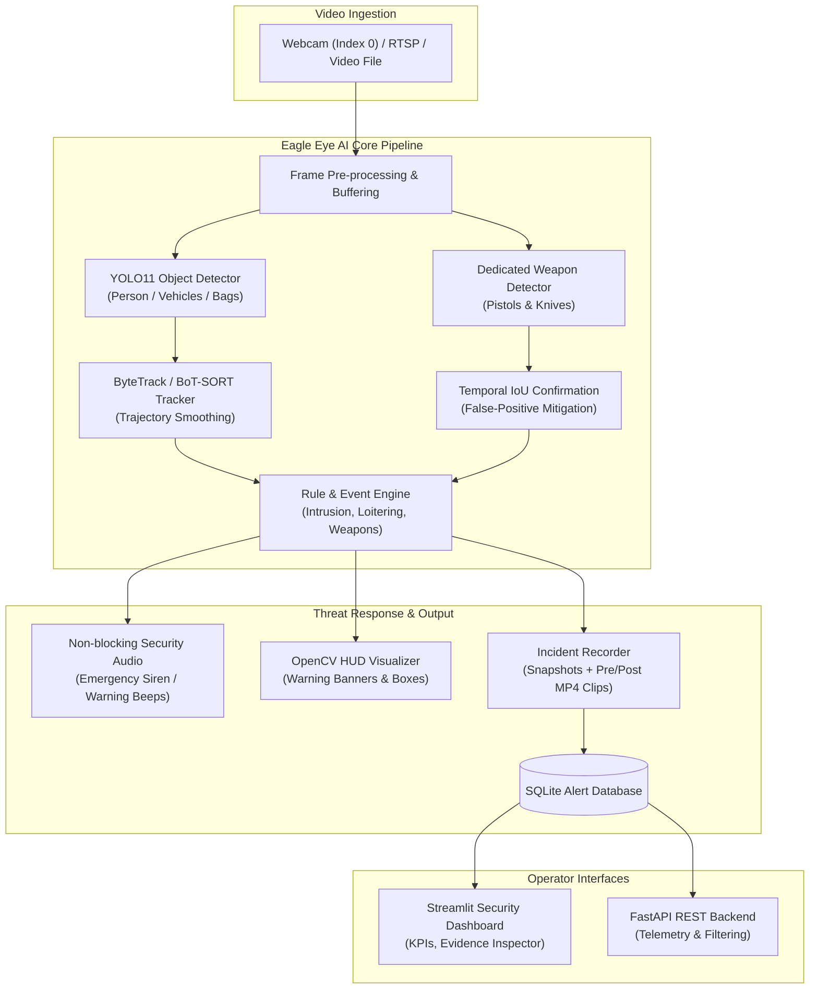

# Eagle Eye AI — Intelligent Real-Time Security Surveillance System

[](https://www.python.org/)
[](https://github.com/ultralytics/ultralytics)
[](https://streamlit.io/)
[](https://fastapi.tiangolo.com/)
[](tests/)
[](LICENSE)

**Eagle Eye AI** is a real-time computer vision security surveillance and threat detection system. Built on an extensible modular architecture, it combines **YOLO11** object detection and tracking with a dedicated **YOLO weapon detector** (pistols & knives), non-blocking **Windows hardware sirens**, temporal confirmation to eliminate false alarms, automated incident evidence capture (pre/post-event video clips + snapshots), and a comprehensive **Streamlit surveillance dashboard**.

---

## Architecture



---

## Key Features

### 1. Dual-Model Computer Vision Pipeline
- **Primary Object Detection**: Runs Ultralytics **YOLO11 Nano** (`yolo11n.pt`) with ByteTrack / BoT-SORT tracking for continuous tracking of people, vehicles, backpacks, suitcases, and bicycles.
- **Dedicated Weapon Detection**: Runs a custom YOLO threat model (`models/rik_best_best.pt`) targeting **pistols** and **knives**.
- **Dynamic Label Resolution**: Model class names are inspected dynamically at startup rather than hardcoded.

### 2. False-Positive Mitigation (Temporal Confirmation)
- Weapons are not alerted on transient, single-frame noise.
- Detections require spatial overlap (IoU $\ge 0.3$) across multiple recent evaluation windows (`confirmation_frames: 2`).
- Frame-skipping scheduling (`inference_interval: 3`) reduces CPU compute while maintaining continuous weapon safety.
- Spatial association automatically links detected weapons to nearby or enclosing person tracks.

### 3. Non-Blocking Live Security Siren & Warning Beeps
- Native Windows audio synthesis via `winsound.Beep` running on an asynchronous, priority-queued background thread.
- **Security Beep (1050 Hz)**: Audible warning for perimeter line crossing, restricted zone intrusion, and loitering.
- **Emergency Siren (1550 Hz / 850 Hz Alternating)**: High-priority alarm triggered on confirmed weapon threats.
- **Priority Preemption**: Emergency sirens immediately preempt and purge lower-priority beeps.
- Rate-limiting, deduplication, and emergency silence methods prevent runaway audio loops.

### 4. Automatic Incident Evidence Recording
- Circular frame buffer continuously retains pre-event footage (3 seconds).
- When a threat or violation occurs, saves:
  1. High-resolution timestamped snapshot (`.jpg`).
  2. Pre-event + post-event incident video clip (`.mp4`).
  3. JSON metadata sidecar containing timestamp, camera ID, zone, weapon category, and confidence.
- Resilient to invalid FPS, missing frames, and codec fallbacks (`mp4v`, `avc1`, `XVID`, `MJPG`).

### 5. Live Heads-Up Display (OpenCV Window)
- **EAGLE EYE AI** top telemetry banner with real-time FPS counter.
- Dynamic Security Status Indicators:
  - 🟢 `MONITORING — NO ACTIVE ALERT`
  - 🟠 `SECURITY WARNING — RESTRICTED AREA INTRUSION`
  - 🔴 `CRITICAL — POSSIBLE WEAPON DETECTED`
- High-contrast red weapon bounding boxes with solid background labels optimized for projector and monitor visibility.

### 6. Centralized Surveillance Dashboard (Streamlit)
- Real-time KPI metric cards: **Total Incidents**, **Weapon Detections**, **High/Critical Alerts**, and **Latest Incident**.
- Multi-dimensional filtering by Camera, Zone, Event Type, and Severity (`critical`, `high`, `medium`, `low`).
- **Incident Evidence Inspector**: Preview snapshots directly in the UI and play incident video clips.

---

## Event Priorities & Sound Mapping

| Security Event | Severity | Default Audio Response | Description |
|---|---|---|---|
| **Weapon Detected** | **Critical** | 🚨 **Emergency Siren** | Confirmed pistol or knife identified |
| **Intrusion Detected** | **High** | 🔔 **Security Beep** | Unauthorized person inside restricted polygon |
| **After-Hours Occupancy** | **High** | 🔔 **Security Beep** | Presence detected outside authorized schedule |
| **Abandoned Object** | **High** | 🔔 **Security Beep** | Unattended bag/luggage left stationary |
| **Wrong-Way Movement** | **Medium** | 🔔 **Optional Beep** | Motion contrary to defined corridor vector |
| **Loitering** | **Medium** | 🔔 **Optional Beep** | Dwell duration exceeds threshold |
| **Line Crossing** | **Medium** | 🔔 **Optional Beep** | Directional tripwire breach |

---

## Getting Started

### Prerequisites
- Windows 10/11
- Python 3.10+ (tested on Python 3.11)
- Laptop webcam (index `0`), external USB camera, RTSP feed, or video file

### Installation

```cmd
git clone https://github.com/adilhosayn/eagle-eye-ai-surveillance.git
cd eagle-eye-ai-surveillance

python -m venv .venv
.venv\Scripts\activate
pip install -r requirements.txt
```

*(Model weights download automatically on first run if not already present)*

---

## Running Eagle Eye AI

### Method 1: 1-Click Interactive Menu
Double-click `run_eagle_eye.bat` to launch the interactive management menu:
- `[1]` Start Live Camera Surveillance (Webcam + Weapons + Siren)
- `[2]` Launch Streamlit Security Dashboard
- `[3]` Start FastAPI Alert Backend
- `[4]` Run Security Audio & Siren Verification Test
- `[5]` Run Automated Test Suite

### Method 2: Command Line (CLI)

#### 1. Live Camera Surveillance
```cmd
python -m src.main --config configs/default.yaml --profile eagle_eye_cpu
```
*(Press `q` inside the video window to stop)*

To run on a recorded video file instead of a webcam:
```cmd
python -m src.main --config configs/default.yaml --profile eagle_eye_cpu --source data/samples/test_video.mp4
```

#### 2. Streamlit Dashboard
```cmd
streamlit run src/api/dashboard.py
```
Opens in your browser at `http://localhost:8501`.

#### 3. FastAPI Alert Backend
```cmd
uvicorn src.api.app:app --host 127.0.0.1 --port 8000 --reload
```
Interactive OpenAPI documentation at `http://localhost:8000/docs`.

#### 4. Audio Verification Test
```cmd
python -m src.utils.security_audio --test
```

---

## Configuration Profiles

Pre-configured profiles in `configs/profiles/`:
- `eagle_eye_cpu.yaml`: Optimized for Intel Core i7 12th Gen / 16GB RAM laptops.
- `eagle_eye_gpu.yaml`: NVIDIA CUDA acceleration profile for high-throughput multi-camera deployments.
- `low_latency.yaml`: Minimal buffering profile for real-time edge streaming.

---

## Testing & Quality Assurance

Eagle Eye AI includes a comprehensive test suite covering detectors, temporal logic, trackers, event rules, audio priorities, and APIs:

```cmd
pytest tests
```

Output:
```
======================= 62 passed in 14.11s =======================
```

---

## License

This project is licensed under the [MIT License](LICENSE).
